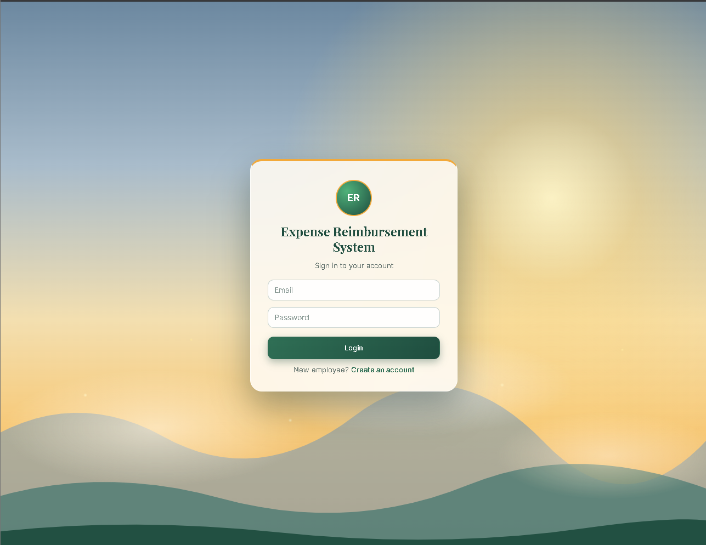
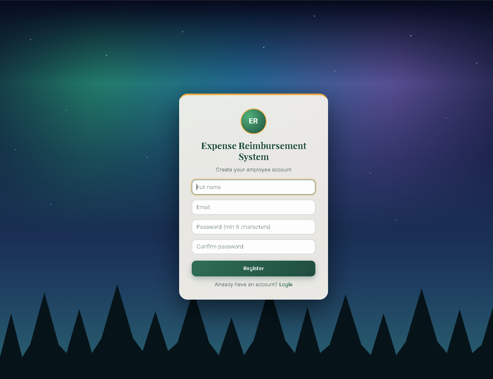
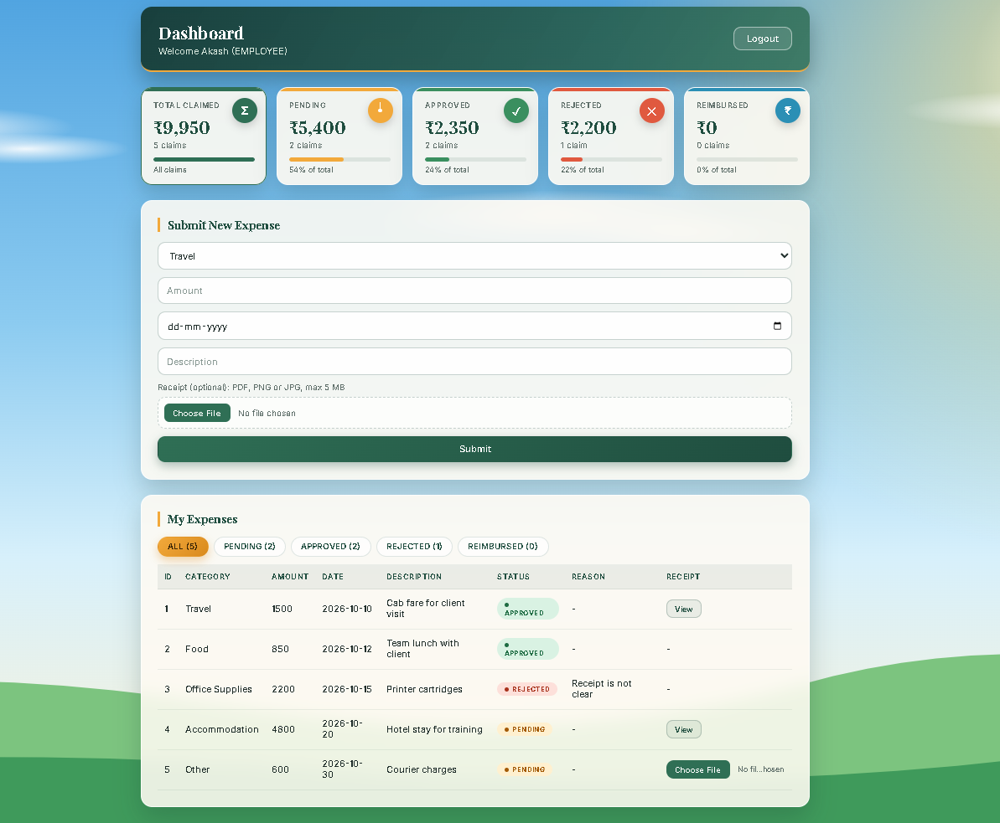
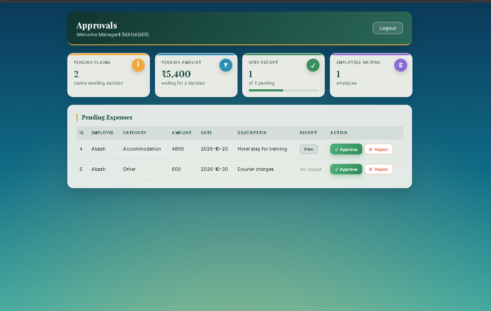
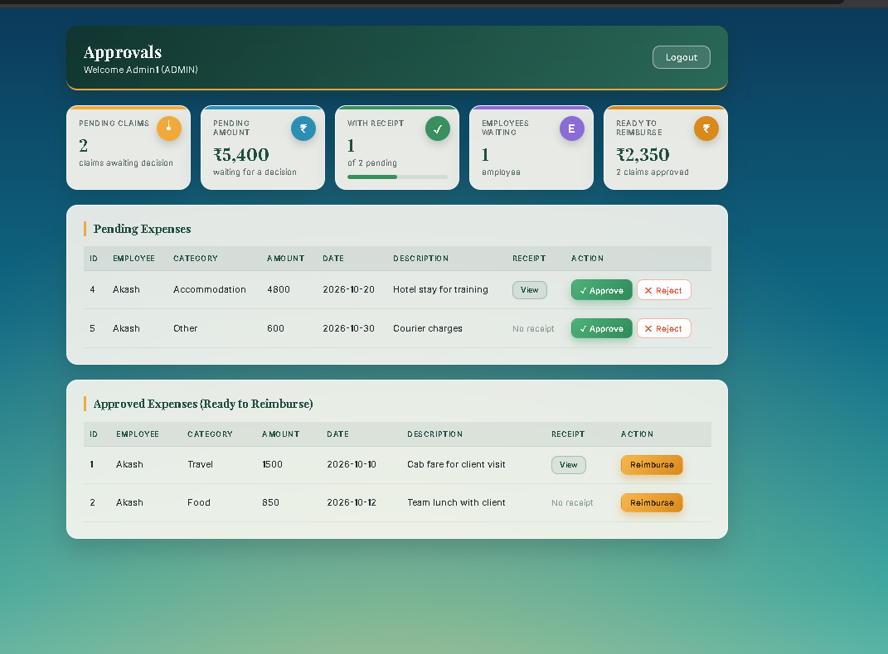

# Expense Reimbursement and Approval System

**Team: SmartCoders**

A full-stack web application for managing office expense claims. Employees submit expenses with receipts, managers approve or reject them, and admins mark approved claims as reimbursed.

## Features

**Employee**
- Register and log in
- Submit an expense (category, amount, date, description) with an optional receipt (PDF, PNG or JPG, max 5 MB)
- Dashboard with summary cards (total, pending, approved, rejected, reimbursed) and a status filter
- See the rejection reason and view uploaded receipts
- Claim details panel with a full audit trail (who did what, and when) and a comment thread between employee and approver
- Search and filter own claims (keyword, status, category, date range, amount range) with sorting and pagination

**Manager**
- Review pending expenses and open their receipts
- Approve, or reject with a required reason
- Claim details panel with a full audit trail (who did what, and when) and a comment thread between employee and approver
- All Claims search with an employee filter, sorting and pagination

**Admin**
- Everything a manager can do
- Reimburse approved expenses
- Create Manager and Admin accounts
- Recent Activity feed of every action across all claims
- All Claims search with an employee filter, sorting and pagination

**General**
- JWT authentication and role-based access control
- Each page has its own animated background, animated screen transitions and button click effects
- Dark and light theme with the choice saved in the browser

## Workflow

```
PENDING -> APPROVED -> REIMBURSED
PENDING -> REJECTED (with a reason)
```

## Tech Stack

| Layer    | Technology                                                                   |
|----------|------------------------------------------------------------------------------|
| Backend  | Java 17, Spring Boot, Spring Security (JWT), Spring Data JPA, Lombok, Maven  |
| Frontend | Angular, TypeScript                                                          |
| Database | MySQL 8                                                                      |

## Project Structure

```
.
├── src/main/java/...      Spring Boot backend (controller, service, repository, entity, dto, config)
├── src/main/resources/    application.properties
├── frontend/              Angular app (pages, services, guards, interceptors)
├── docs/screenshots/      Screenshots used in this README
└── pom.xml
```

## API Endpoints

| Method | Endpoint                      | Access                | Description                    |
|--------|-------------------------------|-----------------------|--------------------------------|
| POST   | /api/auth/register            | Public                | Create an employee account     |
| POST   | /api/auth/login               | Public                | Log in and receive a JWT       |
| POST   | /api/admin/users              | Admin                 | Create a user with any role    |
| POST   | /api/expenses                 | Any logged-in user    | Submit an expense              |
| GET    | /api/expenses/my              | Any logged-in user    | List my expenses               |
| GET    | /api/expenses/pending         | Manager, Admin        | List pending expenses          |
| GET    | /api/expenses/approved        | Admin                 | List approved expenses         |
| PUT    | /api/expenses/{id}/approve    | Manager, Admin        | Approve an expense             |
| PUT    | /api/expenses/{id}/reject     | Manager, Admin        | Reject with a reason           |
| PUT    | /api/expenses/{id}/reimburse  | Admin                 | Mark as reimbursed             |
| POST   | /api/expenses/{id}/receipt    | Expense owner         | Upload a receipt               |
| GET    | /api/expenses/{id}/receipt    | Owner, Manager, Admin | View a receipt                 |
| GET    | /api/expenses/{id}/history    | Owner, Manager, Admin | Audit trail of a claim         |
| GET    | /api/expenses/{id}/comments   | Owner, Manager, Admin | List comments on a claim       |
| POST   | /api/expenses/{id}/comments   | Owner, Manager, Admin | Add a comment                  |
| GET    | /api/audit/recent             | Admin                 | Recent activity across claims  |
| GET    | /api/expenses/search          | Any logged-in user    | Search, filter, sort and paginate claims (employees see only their own) |

## Security

- Passwords are hashed with BCrypt
- Stateless JWT authentication; roles are enforced on the server with `@PreAuthorize`
- Public registration always creates an **Employee**, whatever role the request contains
- Receipts are checked for type and size, saved under a random file name, and only the owner, managers and admins can open them
- CORS allows only `http://localhost:4200`

## Getting Started

### Prerequisites

JDK 17+, Node.js (LTS), Angular CLI, MySQL 8, Maven (or the included Maven wrapper)

### 1. Database

```sql
CREATE DATABASE expense_db;
```

### 2. Backend

Copy `src/main/resources/application.properties.example` to `src/main/resources/application.properties` and set your own values:

```
spring.datasource.url=jdbc:mysql://localhost:3306/expense_db
spring.datasource.username=root
spring.datasource.password=your_password
spring.jpa.hibernate.ddl-auto=update
jwt.secret=change-this-to-a-long-random-secret-key
jwt.expiration=86400000
spring.servlet.multipart.max-file-size=5MB
spring.servlet.multipart.max-request-size=5MB
file.upload-dir=uploads/receipts
```

Run the main application class from IntelliJ, or:

```
./mvnw spring-boot:run
```

The API runs on http://localhost:8080 and creates the tables automatically.

### 3. Frontend

```
cd frontend
npm install
ng serve
```

Open http://localhost:4200.

### 4. Create the first Admin

Registration only creates employees, so the first admin is created once through the database:

1. Open http://localhost:4200/register and create an account
2. Promote it in MySQL:

```sql
USE expense_db;
UPDATE users SET role = 'ADMIN' WHERE email = 'your_email@example.com';
```

3. Log in again with that account

### 5. Create Managers and more Admins

Log in as the admin, copy the token from the login response, and call the admin API (for example in Postman) with the header `Authorization: Bearer <token>`:

```
POST http://localhost:8080/api/admin/users
```

```json
{
  "name": "Manager One",
  "email": "manager@example.com",
  "password": "your_password",
  "role": "MANAGER"
}
```

Use `"role": "ADMIN"` to create another admin.

## Screenshots

| Login | Register |
|-------|----------|
|  |  |

| Employee Dashboard | Manager Approvals |
|--------------------|-------------------|
|  |  |

| Admin Reimbursement |
|---------------------|
|  |

## Known Limitations

- There is no admin page for creating users yet; managers and admins are created through the admin API
- Receipts are stored on the local disk (`uploads/receipts`), not in cloud storage
- Database password and JWT secret live in `application.properties`; use environment variables in production
- No email notifications or password reset

## Team

SmartCoders